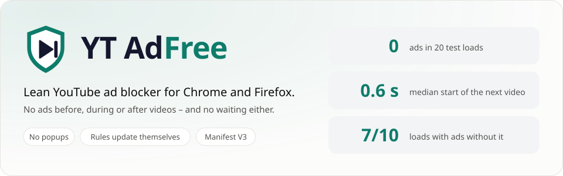
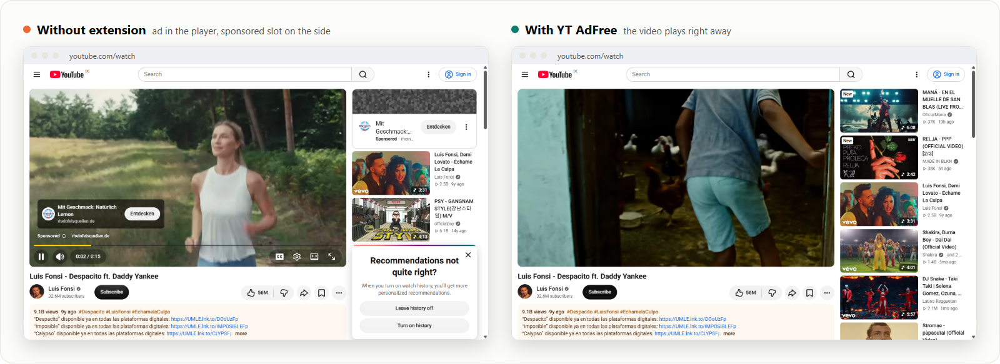
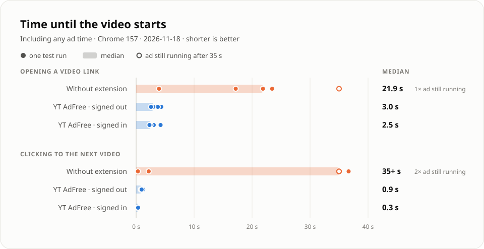
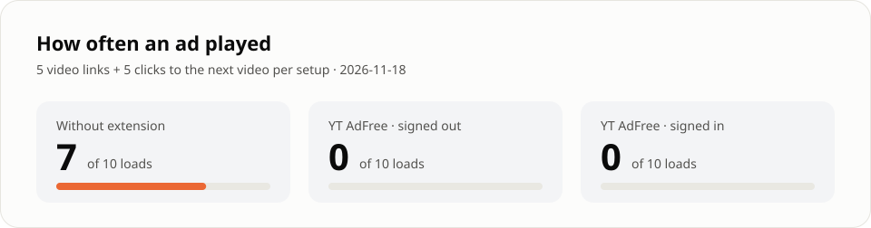
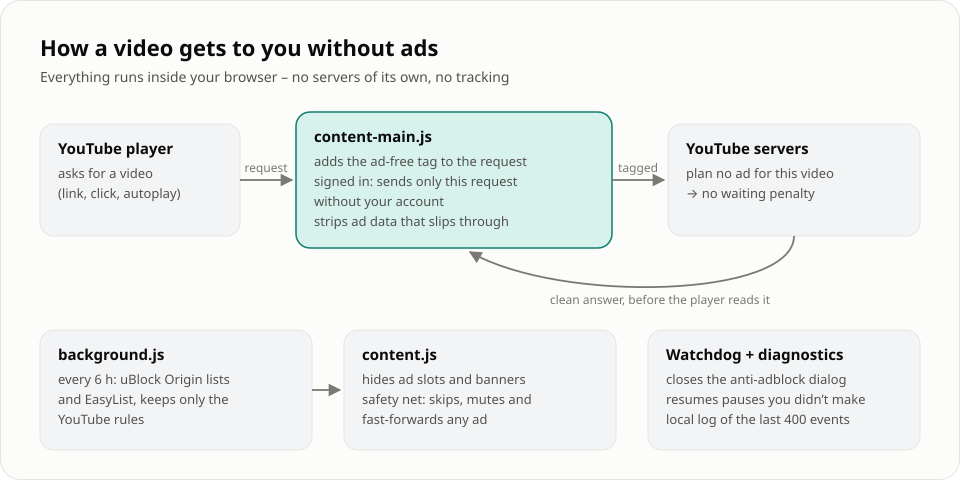
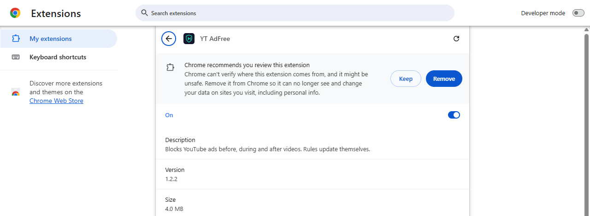

<p align="center">
  <picture>
    <source media="(prefers-color-scheme: dark)" srcset="docs/banner-dark.svg">
    
  </picture>
</p>

<p align="center">
  
  
  
  
  <br>
  <a href="README.md">English</a> · <b>Deutsch</b>
</p>

YT AdFree blockiert YouTube-Werbung vor, in und nach Videos. Es gibt kein Popup und nichts einzustellen, die Regeln halten sich selbst aktuell. Und es umgeht die Falle, in die einfache Blocker tappen: Wird Werbung nur entfernt, hält YouTube das Video so lange zurück, wie die Werbung gedauert hätte. YT AdFree sorgt dafür, dass YouTube gar keine Werbung einplant – das Video startet sofort, angemeldet oder nicht.

## Vorher und nachher

<picture>
  <source media="(prefers-color-scheme: dark)" srcset="docs/compare-dark.png">
  
</picture>

## Messwerte

Die Grafiken sind englisch beschriftet.

<picture>
  <source media="(prefers-color-scheme: dark)" srcset="docs/chart-startup-dark.svg">
  
</picture>

<picture>
  <source media="(prefers-color-scheme: dark)" srcset="docs/chart-ads-dark.svg">
  
</picture>

<details>
<summary>Werte als Tabelle</summary>

| Aufbau | Videolink öffnen: Median (Spanne) | Nächstes Video: Median (Spanne) | Aufrufe mit Werbung |
|---|---:|---:|---:|
| Ohne Erweiterung | 21,9 s (4,0 s – 35+ s) | 35+ s (0,3 s – 35+ s) | 7 / 10 |
| YT AdFree · abgemeldet | 3,0 s (2,6 s – 4,3 s) | 0,9 s (0,8 s – 1,2 s) | 0 / 10 |
| YT AdFree · angemeldet | 2,5 s (2,3 s – 4,2 s) | 0,3 s (0,3 s – 0,3 s) | 0 / 10 |

„35+ s“ = die Werbung lief nach 35 s noch.

Gemessen am 18.11.2026 mit Chrome 157 (Playwright, frisches Profil, Fenster außerhalb des Bildschirms) per [`tools/test/benchmark.js`](tools/test/benchmark.js); Rohdaten in [`docs/data/benchmark.json`](docs/data/benchmark.json). Gemessen wird vom Öffnen bzw. Klicken bis das eigentliche Video läuft, Werbezeit eingerechnet. „Angemeldet“ läuft über den Angemeldet-Pfad der Erweiterung in einer angepassten Kopie, ohne echtes Konto.
</details>

## So funktioniert es

<picture>
  <source media="(prefers-color-scheme: dark)" srcset="docs/architecture-dark.svg">
  
</picture>

| Was | Wie |
|---|---|
| **Werbung vor, in und nach Videos** | Jede Videoanfrage des Players bekommt eine Kennung, bei der YouTube keine Werbung einplant – damit entfällt auch die Strafwartezeit. Was trotzdem an Werbedaten ankommt, wird entfernt, bevor der Player es liest (`content-main.js`). |
| **Angemeldet** | Bei angemeldeten Konten ignoriert YouTube die Kennung. Darum geht nur die Videoanfrage selbst ohne Konto raus (keine Cookies, keine Anmelde-Header). Beim Weiterklicken holt die Erweiterung die werbefreien Videodaten parallel und setzt sie ein, bevor der Player sie sieht – kein Nachladen, kein Anhalten. Kommentare, Empfehlungen, Likes, Abos und Verlauf laufen weiter über dein Konto. Videos, die eine Anmeldung brauchen (Altersfreigabe, Mitglieder, privat), werden normal geladen. |
| **Anti-Adblock-Dialog, Hänger** | Der Dialog wird richtig geschlossen statt nur versteckt (sonst sperrt er Scrollen und Video). YouTubes Hinweis „Kommt es zu Unterbrechungen?“ wird ausgeblendet. Ein Wächter setzt Pausen fort, die nicht von dir kommen, und fordert ein mitten im Video hängendes Video neu an. |
| **Banner, Feed-Anzeigen, Shorts-Werbung, Overlays** | Ausblenden per CSS (`content.js`). Als Reserve wird eine trotzdem laufende Werbung übersprungen bzw. stumm durchgespult, danach Ton und Tempo wiederhergestellt. |

### Immer aktuell, ohne Updates

`background.js` lädt alle 6 Stunden die Filterlisten der uBlock-Origin-Community (inklusive Unterlisten und Quick-Fixes) und EasyList und übernimmt nur die YouTube-Regeln:

- Werbe-Pfade in den Player-Daten (`json-prune`)
- Ausblend-Regeln für die Seite
- Zeitgeber-Regeln gegen Wartezeiten (`nano-stb`)
- Kennungen für werbefreie Anfragen

Fällt eine Quelle aus, versucht die Erweiterung Spiegelserver. Ohne Internet bleiben die letzten Regeln aktiv, und eingebaute Standardregeln greifen immer. Aus den Listen werden nur Schlüssel übernommen, die nach Werbung benannt sind (z. B. `adSlots`, `isAd`), damit nichts anderes auf YouTube kaputtgeht.

## Installieren

### Chrome, Edge, Brave

1. `chrome://extensions` öffnen
2. oben rechts den **Entwicklermodus** einschalten
3. **„Entpackte Erweiterung laden“** und diesen Ordner wählen
4. offene YouTube-Tabs neu laden



Den Ordner danach nicht verschieben, Chrome lädt die Erweiterung direkt von dort. Nach einem Update bei der Erweiterung auf ↻ klicken **und** die YouTube-Tabs neu laden – offene Tabs führen bis dahin den alten Code aus.

### Firefox (ab 128)

```bash
node build-firefox.js
```

Das erzeugt den Ordner `firefox/`. Danach `about:debugging#/runtime/this-firefox` → „Temporäres Add-on laden“ → `firefox/manifest.json`. Das gilt bis zum nächsten Neustart. Für eine dauerhafte Installation muss Mozilla das Add-on signieren (kostenlos, nicht öffentlich gelistet):

```bash
npx web-ext sign --source-dir firefox --channel=unlisted --api-key=… --api-secret=…
```

Die Schlüssel gibt es auf addons.mozilla.org unter „Developer Hub → API-Schlüssel“.

## Diagnose

Die Erweiterung merkt sich lokal die letzten 400 Ereignisse: Anfrage, YouTube-Antwort, erstes Bild, Hänger, Pausen (inklusive welches Skript pausiert hat), Hinweise von YouTube. Sie verlassen den Rechner nicht. Ansehen: in `chrome://extensions` bei YT AdFree „Service Worker“ öffnen und in der Konsole `(await chrome.storage.local.get('diag')).diag` eingeben, oder auf YouTube in der Konsole (Stufe „Ausführlich“) nach `YT AdFree` filtern.

## Projektaufbau

```
manifest.json        Chrome-Manifest (Firefox-Fassung per build-firefox.js)
background.js        lädt und filtert die Regeln alle 6 Stunden
content-main.js      läuft in der YouTube-Seite: werbefreie Anfrage, Datenfilter, Zeitgeber, Wächter, Protokoll
content.js           CSS-Ausblendung, Reserve-Überspringer, Protokoll-Speicher
icons/               Erweiterungs-Icons
docs/                Banner, Diagramme, Screenshots, Messdaten
tools/graphics.js    erzeugt Logo, Banner und Diagramme aus docs/data/benchmark.json
tools/test/          Messlauf, Screenshots, Navigationsprüfung (Playwright)
```

## Selbst nachmessen

```bash
cd tools/test
npm install
npm run benchmark
node ../graphics.js
```

Die Skripte starten das installierte Chrome mit einem leeren Testprofil, dein eigenes Profil bleibt unberührt. `npm run screenshots` nimmt Screenshots und Vergleichsbild neu auf.

## Grenzen

- Die **Regeln** aktualisieren sich selbst, der **Code** einer entpackt geladenen Erweiterung nicht. Baut YouTube grundlegend um, muss der Code angepasst werden.
- Links mit Startzeit (`&t=…`) starten an der richtigen Stelle, aber erst nach einigen Sekunden.
- Werbung nur durchzuspulen hilft allein nicht: YouTubes Server hält das Video dann so lange zurück, wie die Werbung gedauert hätte (gemessen). Darum setzt YT AdFree darauf, dass gar keine Werbung eingeplant wird.
- Ob YouTube in den Stream eingebettete Werbung immer als Werbung markiert, ließ sich nicht prüfen; in den Testläufen kam keine vor.

<sub>Logo entworfen in Claude Design. Die Filterregeln stammen von der [uBlock-Origin](https://github.com/uBlockOrigin/uAssets)-Community und [EasyList](https://easylist.to) und werden zur Laufzeit geladen, nicht mitgeliefert.</sub>
