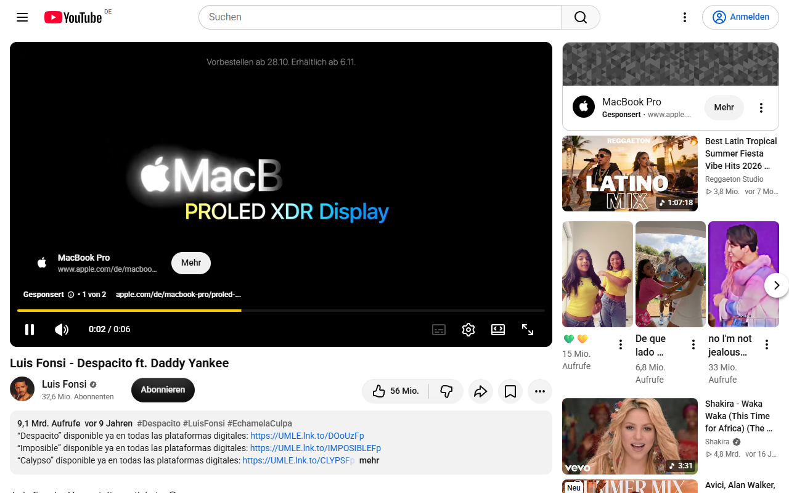
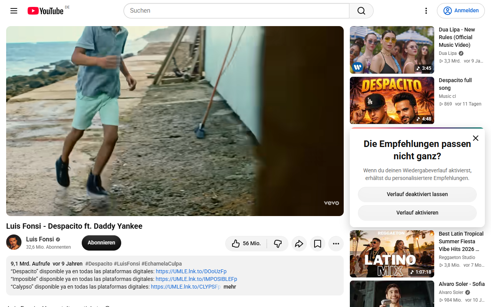
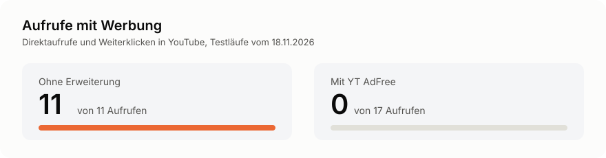
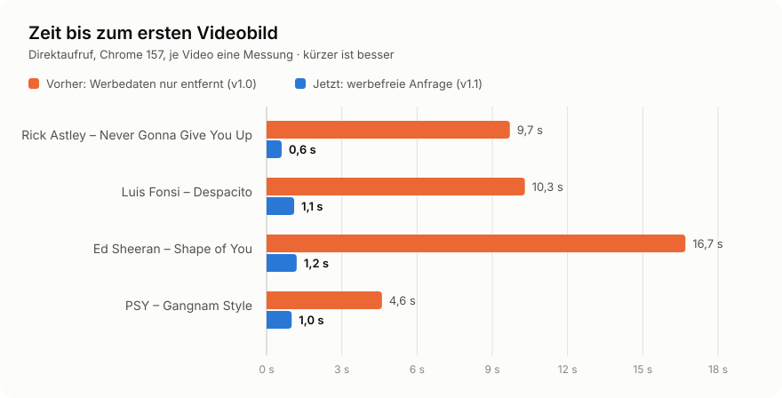
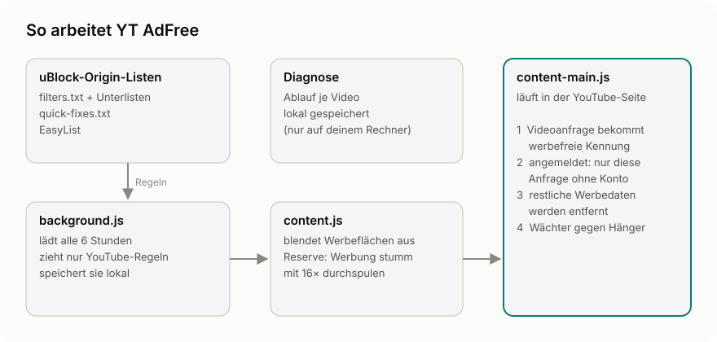
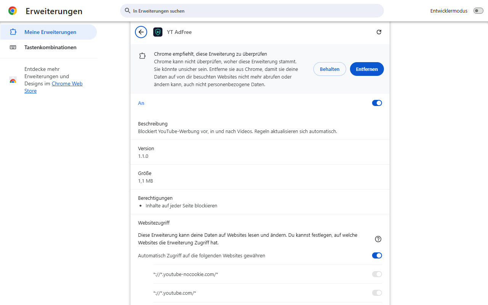

<p align="center">
  <picture>
    <source media="(prefers-color-scheme: dark)" srcset="docs/wordmark-dark.svg">
    
  </picture>
</p>

<p align="center">
  Schlanker YouTube-Werbeblocker für Chrome und Firefox.<br>
  Kein Popup, keine Einstellungen, Regeln aktualisieren sich von selbst.
</p>

<p align="center">
  
  
  
  
</p>

---

## Vorher und nachher

| Ohne Erweiterung | Mit YT AdFree |
|---|---|
|  |  |
| Werbespot im Player („Gesponsert · 1 von 2“) und Anzeige in der Seitenleiste | Das Video startet sofort, die Anzeigenfläche ist weg |

## Messwerte

<picture>
  <source media="(prefers-color-scheme: dark)" srcset="docs/chart-werbung-dark.svg">
  
</picture>

<picture>
  <source media="(prefers-color-scheme: dark)" srcset="docs/chart-startzeit-dark.svg">
  
</picture>

<details>
<summary>Werte als Tabelle</summary>

| Video | Vorher (v1.0) | Jetzt (v1.1) |
|---|---:|---:|
| Rick Astley – Never Gonna Give You Up | 9,7 s | 0,6 s |
| Luis Fonsi – Despacito | 10,3 s | 1,1 s |
| Ed Sheeran – Shape of You | 16,7 s | 1,2 s |
| PSY – Gangnam Style | 4,6 s | 1,0 s |
| Weiterklicken in YouTube (6 Klicks) | 9–15 s | 0,5–0,8 s |

| | Aufrufe | davon mit Werbung |
|---|---:|---:|
| Ohne Erweiterung | 11 | 11 |
| Mit YT AdFree | 17 | 0 |

Gemessen am 18.11.2026 mit Chrome 157 (Playwright, unsichtbares Fenster, frisches Profil). „Vorher“ ist v1.0, die die Werbedaten nur entfernt hat. Daraufhin hielt YouTubes Server das Video so lange zurück, wie die Werbung gedauert hätte.
</details>

## So funktioniert es

<picture>
  <source media="(prefers-color-scheme: dark)" srcset="docs/architektur-dark.svg">
  
</picture>

| Ebene | Wie |
|---|---|
| **Werbung vor, in und nach Videos** | Jede Videoanfrage des Players bekommt eine Kennung, bei der YouTube gar keine Werbung einplant. Damit entfällt auch die Strafwartezeit, mit der YouTube auf fehlende Werbung reagiert. Was trotzdem an Werbedaten ankommt, wird entfernt, bevor der Player es liest. Wird ein Video mit der Kennung unspielbar, schaltet die Erweiterung automatisch um (`content-main.js`). |
| **Eingebettete Werbung und alles, was durchrutscht** | Sobald der Player Werbung anzeigt: „Überspringen“ klicken, stumm schalten, mit 16× durchspulen, danach Ton und Tempo wiederherstellen. Bei eingebetteter Werbung wird nie im Video gesprungen, damit kein Inhalt verloren geht (`content.js`). |
| **Banner, Feed-Anzeigen, Shorts-Werbung, Overlays, Anti-Adblock-Dialog** | Ausblenden per CSS (`content.js`) |
| **Anzeigen- und Tracking-Server** | Netzwerksperre per `declarativeNetRequest` (`rules.json`) |

### Immer aktuell, ohne Updates

`background.js` lädt alle 6 Stunden die Filterlisten der uBlock-Origin-Community (inklusive Unterlisten und Quick-Fixes) und EasyList und übernimmt nur die YouTube-Regeln:

- Werbe-Pfade in den Player-Daten (`json-prune`)
- Ausblend-Regeln für die Seite
- Zeitgeber-Regeln gegen Wartezeiten (`nano-stb`)
- Kennungen für werbefreie Anfragen

Fällt eine Quelle aus, versucht die Erweiterung Spiegelserver. Ohne Internet bleiben die letzten Regeln aktiv, und eingebaute Standardregeln greifen immer. Aus den Listen werden nur Schlüssel übernommen, die nach Werbung benannt sind (z. B. `adSlots`, `isAd`), damit nichts anderes auf YouTube kaputtgeht.

## Installieren

### Chrome, Edge, Brave

1. `chrome://extensions` öffnen
2. oben rechts den **Entwicklermodus** einschalten
3. **„Entpackte Erweiterung laden“** und diesen Ordner wählen
4. offene YouTube-Tabs neu laden



Den Ordner danach nicht verschieben, Chrome lädt die Erweiterung direkt von dort.

### Firefox (ab 128)

```bash
node build-firefox.js
```

Das erzeugt den Ordner `firefox/`. Danach `about:debugging#/runtime/this-firefox` → „Temporäres Add-on laden“ → `firefox/manifest.json`. Das gilt bis zum nächsten Neustart. Für eine dauerhafte Installation muss Mozilla das Add-on signieren (kostenlos, nicht öffentlich gelistet):

```bash
npx web-ext sign --source-dir firefox --channel=unlisted --api-key=… --api-secret=…
```

Die Schlüssel gibt es nach Anmeldung auf addons.mozilla.org unter „Developer Hub → API-Schlüssel“.

## Projektaufbau

```
manifest.json        Chrome-Manifest (Firefox-Fassung per build-firefox.js)
background.js        lädt und filtert die Regeln alle 6 Stunden
content-main.js      läuft in der YouTube-Seite: Anfrage-Kennung, Datenfilter, Zeitgeber
content.js           CSS-Ausblendung und Reserve-Überspringer
rules.json           Netzwerksperre für Anzeigen-Server
icons/               Erweiterungs-Icons
docs/                Logo, Diagramme, Screenshots
tools/grafiken.js    erzeugt Logo und Diagramme neu
tools/test/          Messläufe und Screenshots (Playwright)
```

## Selbst nachmessen

```bash
cd tools/test
npm install
npm run startzeit
```

Die Skripte starten das installierte Chrome mit einem leeren Testprofil. Dein eigenes Profil bleibt unberührt. Weitere Läufe: `npm run navigation`, `npm run weiterklicken`, `npm run screenshots`. Grafiken neu erzeugen: `node tools/grafiken.js`.

## Grenzen

- Die **Regeln** aktualisieren sich selbst, der **Code** einer entpackt geladenen Erweiterung nicht. Baut YouTube grundlegend um, muss der Code angepasst werden.
- Links mit Startzeit (`&t=…`) starten an der richtigen Stelle, aber erst nach einigen Sekunden.
- Ob YouTube in den Stream eingebettete Werbung immer als Werbung markiert, ließ sich nicht prüfen. In den Testläufen kam keine vor.

<sub>Logo entworfen in Claude Design. Die Filterregeln stammen von der [uBlock-Origin](https://github.com/uBlockOrigin/uAssets)-Community und [EasyList](https://easylist.to) und werden zur Laufzeit geladen, nicht mitgeliefert.</sub>
