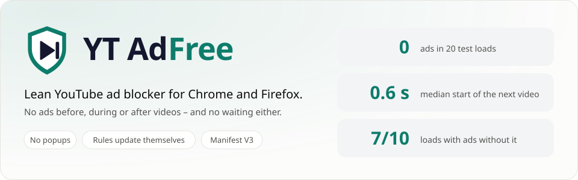
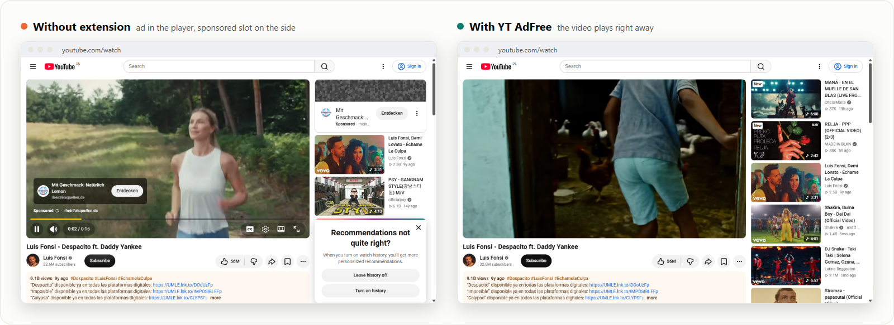
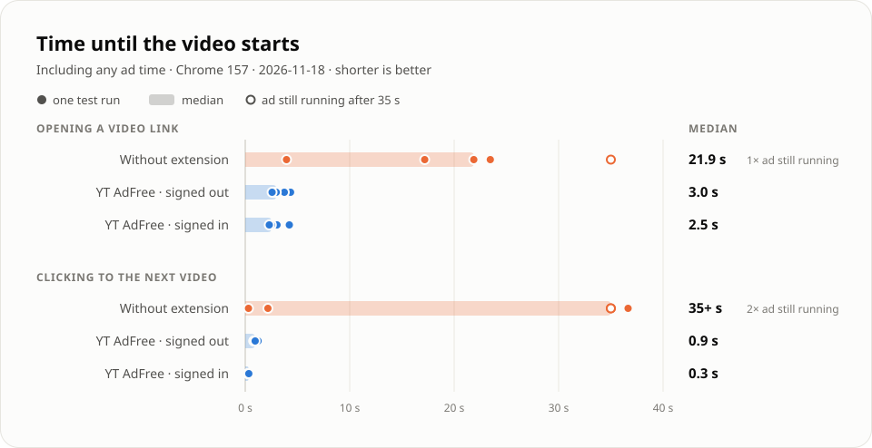
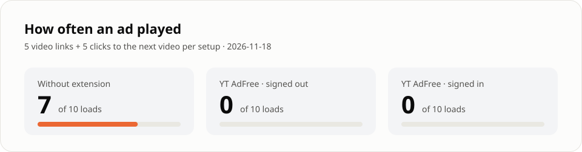
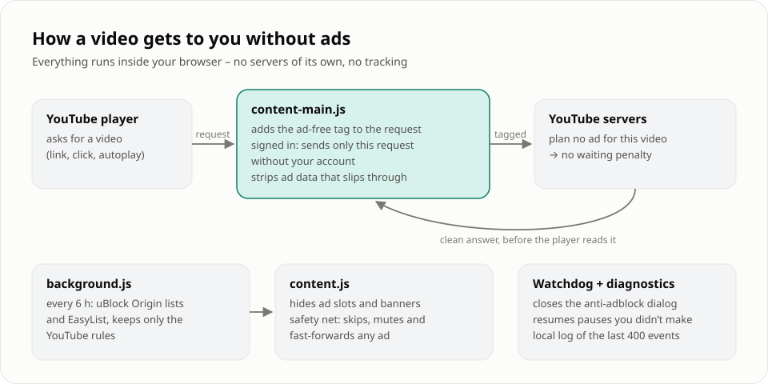
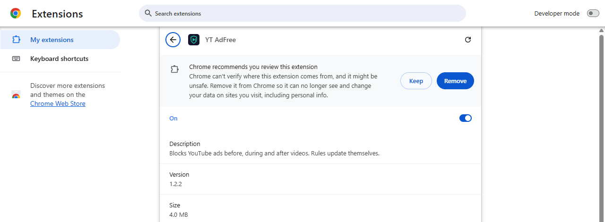

<p align="center">
  <picture>
    <source media="(prefers-color-scheme: dark)" srcset="docs/banner-dark.svg">
    
  </picture>
</p>

<p align="center">
  
  
  
  
  <br>
  <b>English</b> · <a href="README.de.md">Deutsch</a>
</p>

YT AdFree blocks YouTube ads before, during and after videos. There is no popup and nothing to configure, and the blocking rules keep themselves up to date. It also avoids the trap most simple blockers fall into: when an ad is only removed, YouTube holds the video back for as long as the ad would have run. YT AdFree makes sure YouTube never schedules the ad in the first place, so the video starts right away, signed in or not.

## Before and after

<picture>
  <source media="(prefers-color-scheme: dark)" srcset="docs/compare-dark.png">
  
</picture>

## Measurements

<picture>
  <source media="(prefers-color-scheme: dark)" srcset="docs/chart-startup-dark.svg">
  
</picture>

<picture>
  <source media="(prefers-color-scheme: dark)" srcset="docs/chart-ads-dark.svg">
  
</picture>

<details>
<summary>Numbers as a table</summary>

| Setup | Opening a video link: median (range) | Next video: median (range) | Loads with an ad |
|---|---:|---:|---:|
| Without extension | 21.9 s (4.0 s – 35+ s) | 35+ s (0.3 s – 35+ s) | 7 / 10 |
| YT AdFree · signed out | 3.0 s (2.6 s – 4.3 s) | 0.9 s (0.8 s – 1.2 s) | 0 / 10 |
| YT AdFree · signed in | 2.5 s (2.3 s – 4.2 s) | 0.3 s (0.3 s – 0.3 s) | 0 / 10 |

“35+ s” = the ad was still running after 35 s.

Measured on 2026-11-18 with Chrome 157 (Playwright, fresh profile, window off-screen) using [`tools/test/benchmark.js`](tools/test/benchmark.js); raw data in [`docs/data/benchmark.json`](docs/data/benchmark.json). Times run from opening the link or clicking until the actual video plays, ad time included. “Signed in” takes the extension’s signed-in code path in a patched copy; a real account was not used.
</details>

## How it works

<picture>
  <source media="(prefers-color-scheme: dark)" srcset="docs/architecture-dark.svg">
  
</picture>

| What | How |
|---|---|
| **Ads before, during and after videos** | Every video request from the player gets a tag that makes YouTube schedule no ads – so there is no waiting penalty either. Any ad data that still arrives is removed before the player reads it (`content-main.js`). |
| **Signed in** | YouTube ignores that tag for signed-in accounts. So only the video request itself goes out without your account (no cookies, no sign-in headers). When you click to the next video, the extension fetches the ad-free video data in parallel and swaps it in before the player sees it – no reload, no pause. Comments, recommendations, likes, subscriptions and watch history still run on your account. Videos that need a sign-in (age-restricted, members-only, private) are loaded normally. |
| **Anti-adblock dialog, hiccups** | The dialog is closed properly instead of just hidden (otherwise it blocks scrolling and the video). YouTube’s “Experiencing interruptions?” snackbar is hidden. A watchdog resumes pauses you didn’t make and re-requests a video that stalls mid-way. |
| **Banners, feed ads, Shorts ads, overlays** | Hidden with CSS (`content.js`). As a safety net, an ad that still plays is skipped or muted and fast-forwarded, and the original volume and speed are restored afterwards. |

### Always up to date, no updates needed

Every 6 hours `background.js` downloads the filter lists maintained by the uBlock Origin community (including sub-lists and quick fixes) plus EasyList and keeps only the YouTube rules:

- ad paths in the player data (`json-prune`)
- hiding rules for the page
- timer rules against waiting penalties (`nano-stb`)
- tags for ad-free requests

If a source is down, mirrors are tried. Offline, the last rules stay active, and built-in defaults always apply. Only keys named after ads (such as `adSlots`, `isAd`) are taken from the lists, so nothing else on YouTube breaks.

## Install

### Chrome, Edge, Brave

1. Open `chrome://extensions`
2. Turn on **Developer mode** (top right)
3. Click **Load unpacked** and pick this folder
4. Reload any open YouTube tabs



Don’t move the folder afterwards – Chrome loads the extension straight from there. After an update, click ↻ on the extension **and** reload your YouTube tabs; open tabs keep running the old code until then.

### Firefox (128+)

```bash
node build-firefox.js
```

This creates the `firefox/` folder. Then open `about:debugging#/runtime/this-firefox` → “Load Temporary Add-on” → `firefox/manifest.json`. That lasts until the next restart. For a permanent install Mozilla has to sign the add-on (free, not publicly listed):

```bash
npx web-ext sign --source-dir firefox --channel=unlisted --api-key=… --api-secret=…
```

You get the keys on addons.mozilla.org under “Developer Hub → Manage API Keys”.

## Diagnostics

The extension keeps a local log of the last 400 events: request, YouTube’s answer, first frame, stalls, pauses (including which script paused), hints from YouTube. It never leaves your computer. To read it, open the extension’s “service worker” on `chrome://extensions` and run `(await chrome.storage.local.get('diag')).diag` in its console, or filter the YouTube tab’s console (level “Verbose”) for `YT AdFree`.

## Project layout

```
manifest.json        Chrome manifest (Firefox version via build-firefox.js)
background.js        downloads and filters the rules every 6 hours
content-main.js      runs inside the YouTube page: ad-free request, data filter, timers, watchdog, log
content.js           CSS hiding, safety-net skipper, log storage
icons/               extension icons
docs/                banner, charts, screenshots, benchmark data
tools/graphics.js    regenerates logo, banner and charts from docs/data/benchmark.json
tools/test/          benchmark, screenshots, navigation checks (Playwright)
```

## Measure it yourself

```bash
cd tools/test
npm install
npm run benchmark
node ../graphics.js
```

The scripts start your installed Chrome with an empty test profile; your own profile is not touched. `npm run screenshots` retakes the screenshots and the comparison image.

## Limits

- The **rules** update themselves, the **code** of an unpacked extension does not. If YouTube changes something fundamental, the code has to be adapted.
- Links with a start time (`&t=…`) start at the right spot, but only after a few seconds.
- Fast-forwarding ads does not help on its own: YouTube’s servers then hold the video back for the length of the ad (measured). That is why YT AdFree relies on no ad being scheduled at all.
- Whether YouTube always marks ads stitched into the stream as ads could not be verified; none showed up in the test runs.

<sub>Logo designed in Claude Design. The filter rules come from the [uBlock Origin](https://github.com/uBlockOrigin/uAssets) community and [EasyList](https://easylist.to); they are downloaded at runtime, not bundled.</sub>
